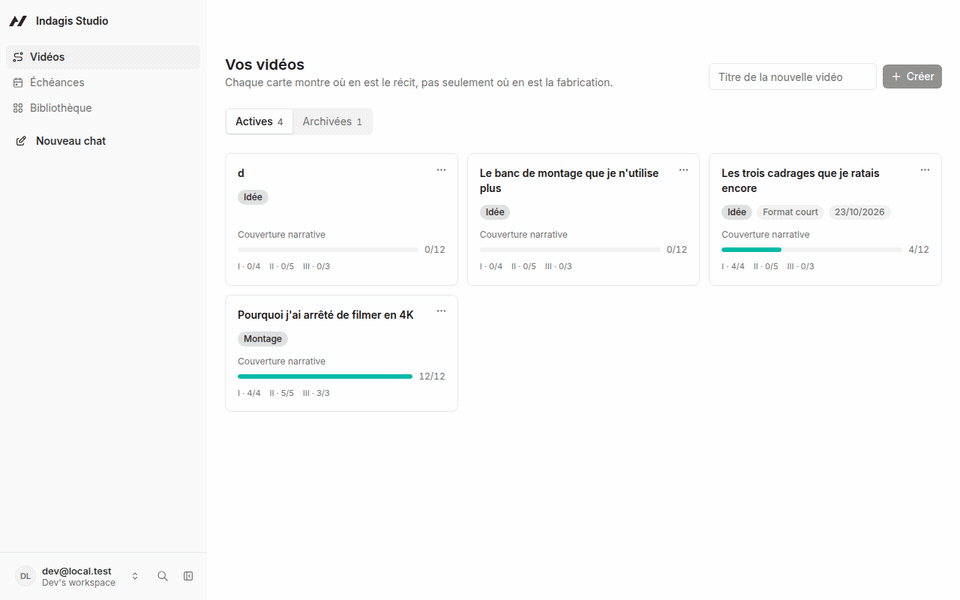
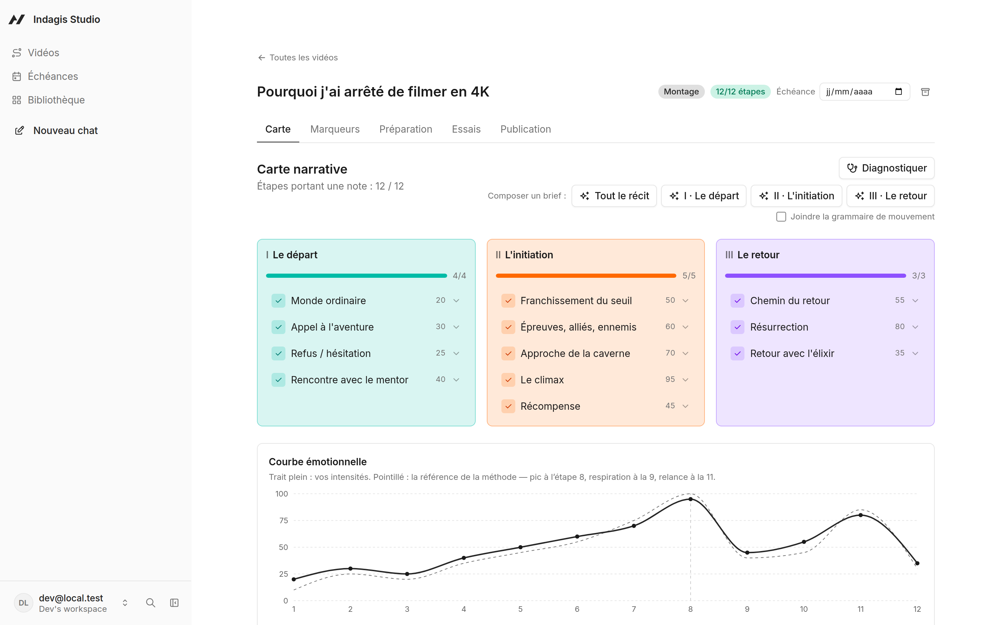
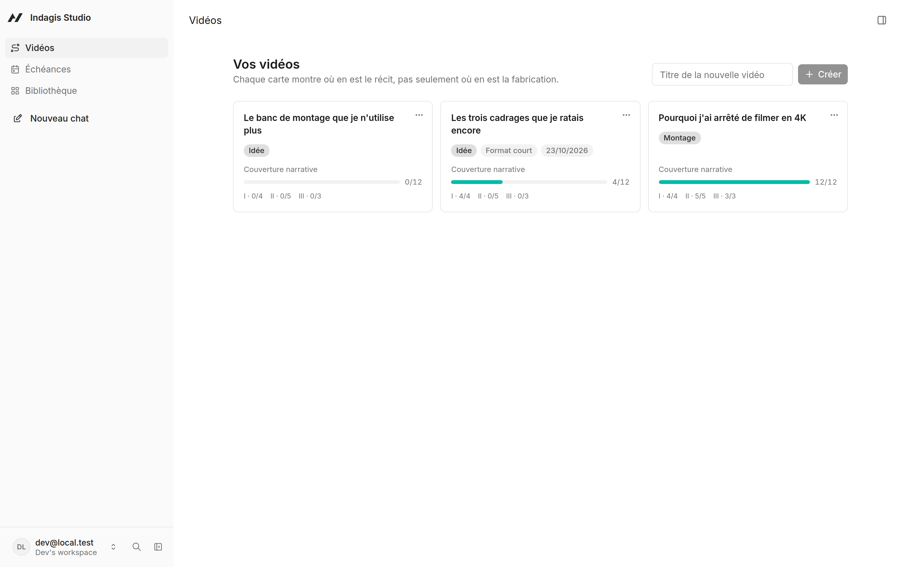
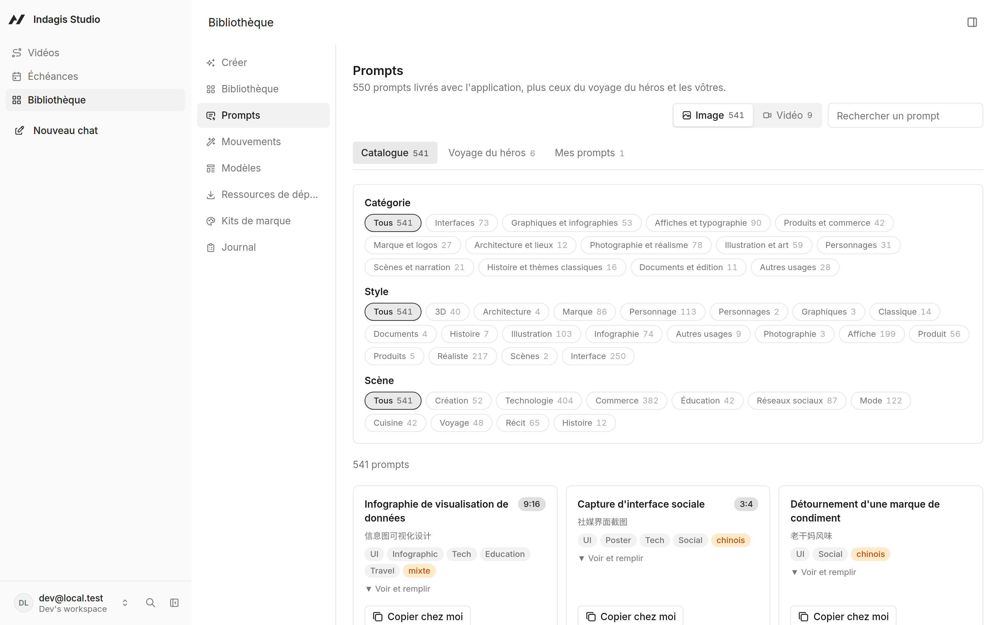
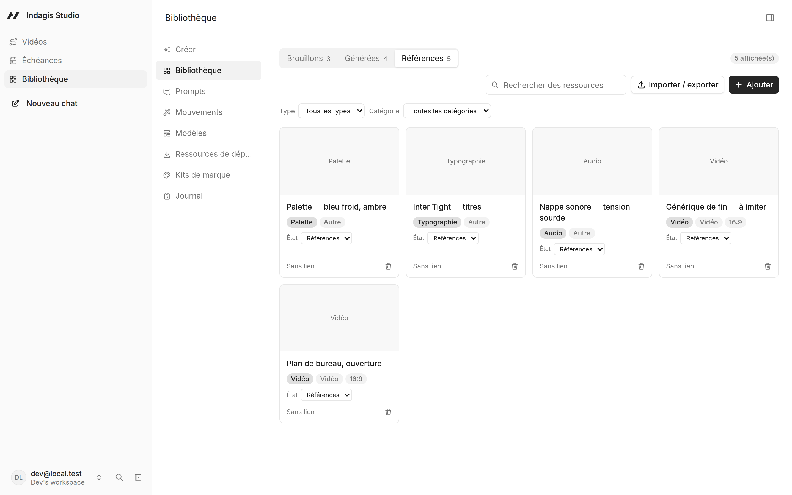
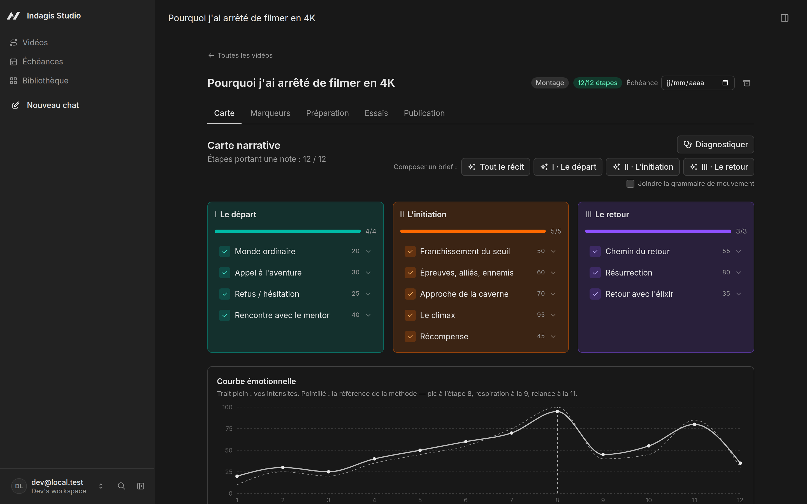

<p align="left">
  <picture>
    <source media="(prefers-color-scheme: dark)" srcset="https://shieldcn.dev/header/graph.svg?title=Indagis%20Studio&subtitle=Structurer%20un%20montage%20comme%20un%20r%C3%A9cit&align=left&mode=dark" />
    
  </picture>
</p>

<p align="left">
  <a href="https://github.com/agtktID/indagisdisign/actions/workflows/ci.yml"><picture>
    <source media="(prefers-color-scheme: dark)" srcset="https://shieldcn.dev/github/ci/agtktID/indagisdisign.svg?variant=secondary&mode=dark" />
    
  </picture></a>
  <a href="LICENSE"><picture>
    <source media="(prefers-color-scheme: dark)" srcset="https://shieldcn.dev/github/license/agtktID/indagisdisign.svg?variant=secondary&mode=dark" />
    
  </picture></a>
  <a href="https://github.com/agtktID/indagisdisign/commits"><picture>
    <source media="(prefers-color-scheme: dark)" srcset="https://shieldcn.dev/github/last-commit/agtktID/indagisdisign.svg?variant=secondary&mode=dark" />
    
  </picture></a>
  <picture>
    <source media="(prefers-color-scheme: dark)" srcset="https://shieldcn.dev/badge/donn%C3%A9es-100%25%20locales-green.svg?variant=secondary&logo=false&mode=dark" />
    
  </picture>
</p>

Vous avez quarante minutes de rushes et une timeline vide. Indagis Studio tient **la carte
de votre récit** — les 12 étapes du voyage du héros, rattachées aux timecodes réels de vos
fichiers — et vous dit **ce qui manque à votre histoire** avant que le montage ne vous le
fasse payer.



---

## Le problème

Le problème n'est pas technique : vous savez couper. C'est que vous ne savez pas encore
quelle histoire vous racontez, et vous le découvrirez au montage — trop tard, après six
heures sur un acte II qui ne tient pas.

| Vos outils actuels | Ce qu'ils savent faire | Ce qu'ils ignorent |
| --- | --- | --- |
| Resolve, Premiere | couper, étalonner, exporter | si votre récit tient debout |
| Notion, Trello | suivre où en est la fabrication | ce qu'il y a **dans** vos rushes |
| Un document de script | poser une intention | la confronter aux plans tournés |

Indagis Studio occupe l'espace entre les trois. Ce n'est ni un logiciel de montage, ni un
gestionnaire de tâches — et il n'écrit pas à votre place : il aide à **nommer** ce que
vous avez déjà filmé.

## Démarrer

Il faut **Node.js 22.22 ou plus** et **pnpm**.

```bash
git clone https://github.com/agtktID/indagisdisign.git
cd indagisdisign
corepack enable
pnpm install
pnpm dev
```

L'application s'ouvre sur `http://localhost:8080`. Choisissez **« Continuer comme
développeur local »** — aucun compte, aucun mot de passe.

Pour que l'agent réponde, connectez un modèle depuis l'interface : votre clé Anthropic ou
OpenAI, un modèle Ollama en local, ou les crédits gratuits de Builder.io.

## Ce que ça fait

| | |
| --- | --- |
| **La carte narrative** | Les 12 étapes en 3 actes, avec votre courbe d'intensité face à celle de la méthode. L'écart entre les deux est le diagnostic. |
| **Le carnet de marqueurs** | Vos passages repérés, avec leurs timecodes réels, réordonnables selon le récit et non la chronologie. |
| **Le diagnostic** | Douze règles appliquées à votre carte : acte sous-doté, climax sans matière, fin déconnectée, courbe plate. |
| **Les exports** | CSV, **EDL d'assemblage** pour Resolve et Premiere, chapitres YouTube. Rien ne part sur un serveur. |
| **Les imports** | Collez un bloc de dérushage, ou donnez votre CSV/EDL. Une lecture à blanc montre ce qui serait créé **et refusé**, ligne par ligne, avant d'écrire. |
| **Le brief de composition** | Un bouton par acte transforme vos notes et vos timecodes en consigne pour l'agent — « fais-moi un teaser de l'acte III depuis ma carte ». |
| **La grammaire de mouvement** | 121 chorégraphies déconstruites, triées **par étape du voyage** : la question n'est pas « montre-moi les transitions » mais « qu'est-ce qui sert mon climax ? ». |
| **La bibliothèque** | 550 prompts livrés, vos ressources rangées par type, catégorie et format, importables et exportables en CSV ou JSON. |
| **L'agent** | Il travaille sur vos données, par le chat plein écran ou le panneau latéral. |

**Tout reste sur votre machine.** Aucun compte à créer, aucune donnée qui part ailleurs.

L'interface suit la langue de votre navigateur parmi onze. Le contenu de la méthode reste
en français en toutes langues : c'est un référentiel transcrit de sa source, pas de la
donnée traduisible.

## Comment on s'en sert

1. **Posez vos marqueurs** — un passage repéré dans un rush, avec son timecode.
2. **Rattachez-les aux 12 étapes.** Une étape peut rester vide : c'est une information,
   pas une faute.
3. **Écrivez ce que chaque étape doit faire.** Une phrase suffit. C'est la note, et non le
   marqueur, qui rend une étape « couverte » — on peut avoir la matière sans l'intention.
4. **Demandez un diagnostic.** Il dit où ça cède, et chaque remarque déplie l'étape
   concernée.
5. **Montez.** Exportez en EDL, ou demandez un brief de composition pour un acte entier.

## À quoi ça ressemble

**La carte narrative**, le cœur du produit : les 12 étapes en 3 actes, votre courbe
d'intensité en trait plein, celle de la méthode en pointillé.



| | |
| --- | --- |
| **Le carnet de marqueurs** — chaque moment repéré, rattaché à une étape, triable en ordre narratif. |  |
| **Vos vidéos** — chaque carte montre où en est le récit, pas seulement la fabrication. |  |
| **Le catalogue de prompts** — 550 prompts triables par catégorie, style et scène. |  |
| **La bibliothèque** — vos ressources rangées par type, catégorie et format. |  |

Le thème suit celui de votre système, et les deux sont tenus : couleurs d'actes, courbe et
barres de couverture sont redéfinies pour chacun, pas seulement assombries.

| | |
| --- | --- |
|  |  |

> Ces captures sont **régénérables** : ce qu'elles montrent est du code, pas une base
> locale. Voir [`tools/captures/README.md`](tools/captures/README.md).

## Fabriquer des vidéos depuis vos cartes

L'agent peut transformer une carte narrative en composition vidéo. Deux moteurs sont
branchés comme **ponts locaux**, démarrés avec l'application.

| Moteur | Licence |
| --- | --- |
| [HyperFrames](https://github.com/heygen-com/hyperframes) | Apache-2.0 — proposé par défaut |
| [Remotion](https://www.remotion.dev) | source-available, **pas open source** |

Le rendu se fait **sur votre machine** : il faut Chrome et ffmpeg. Pour vérifier :

```bash
node tools/hyperframes-bridge/smoke-test.mjs
node tools/remotion-bridge/smoke-test.mjs
```

**Remotion est gratuit pour les particuliers, les associations et les entreprises de trois
salariés au plus** ; au-delà, une licence d'entreprise est requise
([remotion.pro/license](https://www.remotion.pro/license)). Indagis Studio ne le distribue
pas : le pont l'installe à la demande dans votre projet vidéo, et c'est à ce moment que
vous acceptez sa licence.

Les ponts exécutent des commandes sur votre machine. Ils sont volontairement étroits —
liste blanche de sous-commandes, jamais de shell, écritures confinées au dossier `video/`.
Pour vous en passer, supprimez `mcp.config.json` : l'application fonctionne sans.

## Sous le capot

Construit sur [Agent-Native](https://www.agent-native.com) (MIT), en application autonome.

```
actions/               45 actions métier — chacune est à la fois outil d'agent,
                       hook React, route HTTP et commande en ligne
server/db/             12 tables PostgreSQL (PGlite en local)
shared/                la méthode : 12 étapes, 3 actes, 5 questions, 5 symptômes
shared/prompt-catalog/ 550 prompts, généré — voir tools/prompt-catalog/
shared/motion-grammar/ 121 recettes de mouvement, généré — voir tools/motion-grammar/
app/routes/            4 écrans : les vidéos, la fiche, le calendrier, la bibliothèque
.agents/               ce que l'agent sait faire
tools/                 les ponts vidéo et les générateurs de catalogues
```

La méthode vit dans `shared/hero-journey.ts`, pas en base : c'est du référentiel, pas de
la donnée utilisateur. Même principe pour les deux catalogues — livrés dans le code, donc
présents dès l'installation, et modifiables uniquement en les copiant.

### Vérifier

```bash
bash scripts/verifier.sh
```

Vingt-huit critères, chacun avec la commande qui le démontre, et une section finale sur ce
qui reste **non prouvé** — le script ne prétend pas que tout est vérifié quand ça ne l'est
pas. S'y ajoutent **229 tests**, dont le contrat d'écriture de chaque action contre une
vraie base.

## Documentation

| Document | Ce qu'il contient |
| --- | --- |
| [`docs/ETAT-DU-PROJET.md`](docs/ETAT-DU-PROJET.md) | Ce qui est fait, ce qui reste, et la commande qui reprouve chaque ligne |
| [`AGENTS.md`](AGENTS.md) | Le contrat technique, pour les agents comme pour les humains |
| [`CONTRIBUTING.md`](CONTRIBUTING.md) | Les règles du projet et les portes à passer |
| [`CREDITS.md`](CREDITS.md) | L'attribution du contenu de tiers |
| [`SECURITY.md`](SECURITY.md) | Signaler une faille — **pas** par une issue publique |

## Licence

[MIT](LICENSE).

Le projet embarque du contenu de tiers conservé avec son attribution : 550 prompts sous
licence MIT, et la méthode narrative transcrite de sa source. Le détail est dans
[CREDITS.md](CREDITS.md).
